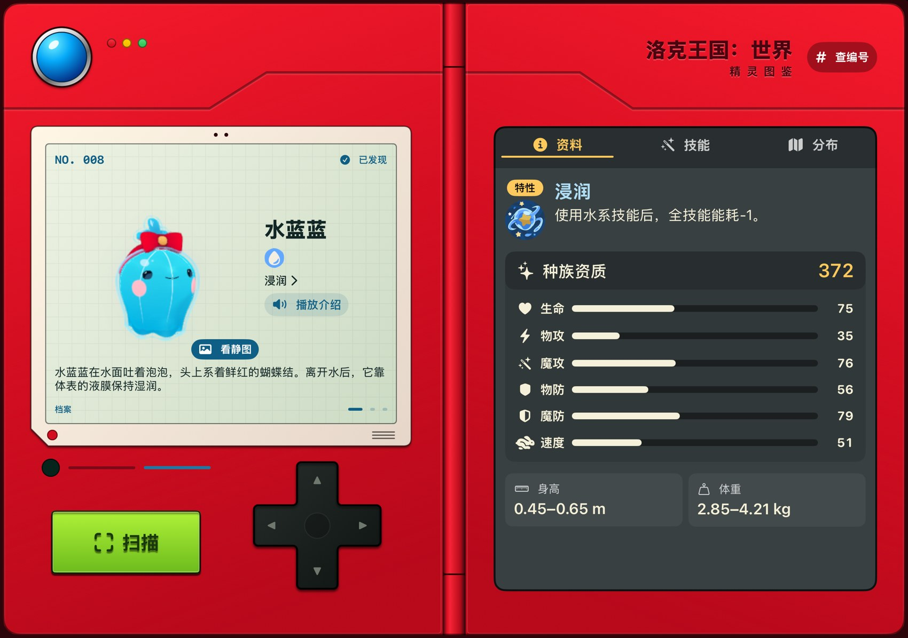
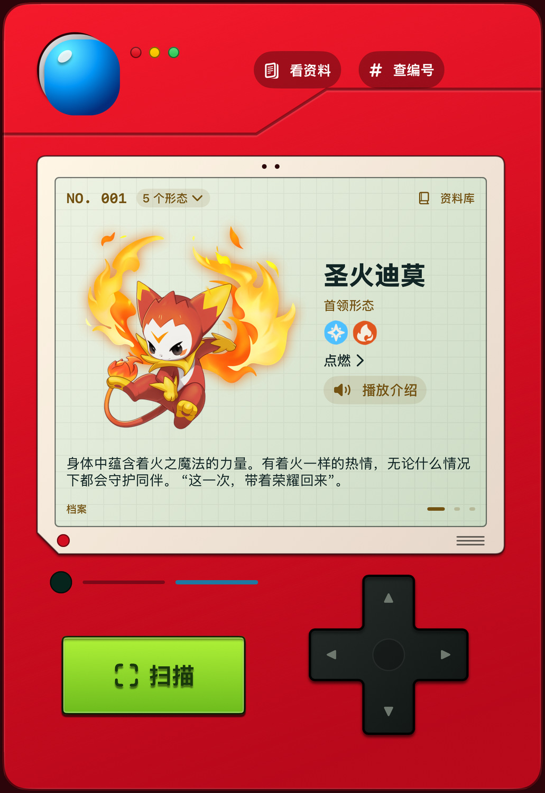
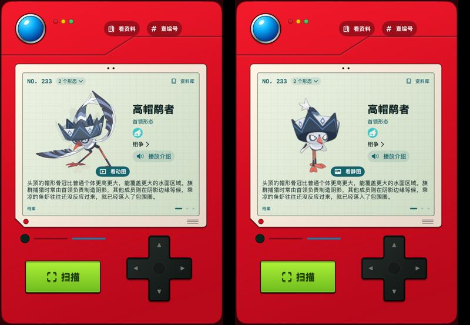
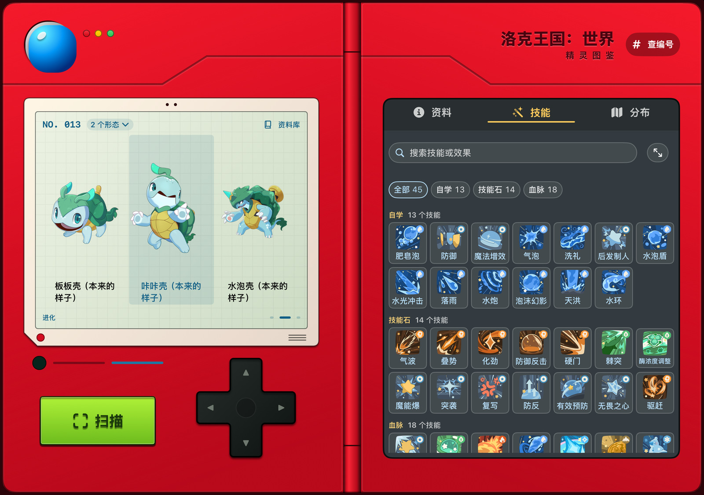
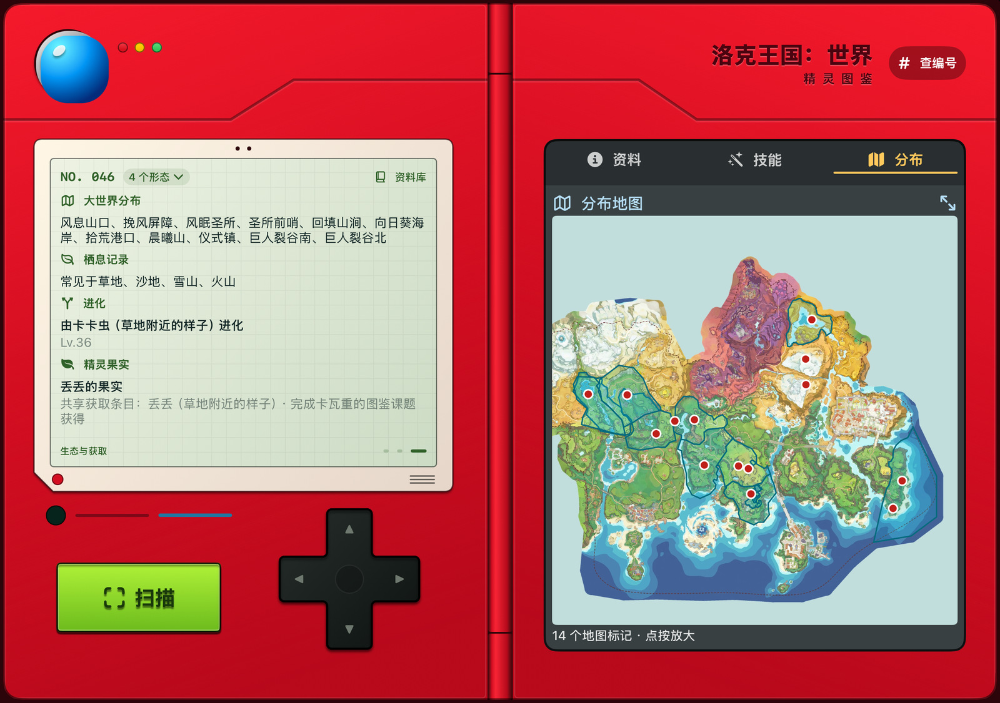

<div align="center">

# RocoDex · Creature Field Guide

[简体中文](README.md) · **English** · [日本語](README.ja.md) · [한국어](README.ko.md)

An unofficial offline field guide to **洛克王国：世界**, designed for the two screens of iPhone Duo.

**1.6.2 · build 9**　|　**iOS 27.0 or later**　|　**496 catalog numbers · 665 creature forms**

[Download 1.6.2](https://github.com/liudbhx7-bot/roco-world-duo-dex/releases/tag/v1.6.2) · [Installation guide](docs/BUILDING.md) · [Changelog](CHANGELOG.md)

</div>

Point the camera at a creature illustration and press the green **扫描** (Scan) key. A successful match opens the creature’s entry and adds its form to your discovery log. Unfold Duo to browse the portrait on the left and its abilities, skills or habitat on the right. On the folded screen, tap **看资料** (View details) to switch panels. Recognition, maps and narration all work offline.

The app interface is in Simplified Chinese and the audio is in Mandarin. The Chinese labels and creature names below match what you’ll see in the app.

| Unfolded · 水蓝蓝 and its base stats | Folded · a single-screen entry |
| :---: | :---: |
| <a href="docs/images/waterblue-duo-1.6.1.jpg"></a> | <a href="docs/images/duo-folded-archive.jpg"></a> |

## See the new animations

Look up **421 离心舞者** to watch its entrance flow into its idle loop. For a side-by-side comparison with the illustration, look up **233**, choose the boss form **高帽鹬者**, and tap the toggle in the lower-right corner of the portrait. The bird folds its wings at rest while its crest and feet stay in view. Tap **播放介绍** (Play introduction) to hear the mechanical cue and watch the blue indicator pulse with the voice.



## Download and install

**On your iPhone.** Download the two parts of the unsigned IPA and the checksum file into the same folder on your Mac. [Part 1](https://github.com/liudbhx7-bot/roco-world-duo-dex/releases/download/v1.6.2/RocoDex-1.6.2-unsigned.ipa.part1) · [Part 2](https://github.com/liudbhx7-bot/roco-world-duo-dex/releases/download/v1.6.2/RocoDex-1.6.2-unsigned.ipa.part2) · [SHA256SUMS.txt](https://github.com/liudbhx7-bot/roco-world-duo-dex/releases/download/v1.6.2/SHA256SUMS.txt)

In that folder, run the following commands. When all three files report `OK`, sign the assembled IPA with your Apple development certificate and a provisioning profile for your device, then install it. To keep an existing discovery log, install over your current copy using the same bundle ID and a compatible signing identity.

```sh
cat RocoDex-1.6.2-unsigned.ipa.part1 RocoDex-1.6.2-unsigned.ipa.part2 > RocoDex-1.6.2-unsigned.ipa
shasum -a 256 -c SHA256SUMS.txt
```

**Build from source on a Mac.** Unzip the source archive, open `RocoDex.xcodeproj` in Xcode and select the RocoDex scheme. Choose the iPhone Duo simulator and press **⌘R**, or select your own signing team and connected iPhone. This release was built with Xcode 27.2. [Source ZIP](https://github.com/liudbhx7-bot/roco-world-duo-dex/archive/refs/tags/v1.6.2.zip) · [Build and update instructions (Chinese)](docs/BUILDING.md)

## Explore an entry

1. Tap **查编号** (Look up number), enter **013**, then tap **查找** (Find) to open 咔咔壳. Leave the number blank to open the roster and filter by name, form or type.
2. Press right on the D-pad, or tap **技能** (Skills) on the right screen. The left panel shows the evolution branches. The right panel lists 45 skills for 咔咔壳. Tap **肥皂泡** to see that this Water-type magic attack is learned at level 1, costs 1 energy and has 60 power.
3. Open **生态与获取** (Habitat and acquisition) to see how to obtain the creature. Tap the map to zoom, pan and select locations. To compare forms, look up **046 卡瓦重** and use the form selector at the top left.

| Evolution and skills for 咔咔壳 | Habitat map for 卡瓦重 |
| :---: | :---: |
| <a href="docs/images/evolution-and-skills.jpg"></a> | <a href="docs/images/habitat-map.jpg"></a> |

The bird comparison is from 1.6.2, the unfolded 水蓝蓝 screenshot from 1.6.1, and the other examples from 1.5. [Open the skill detail screenshot](docs/images/skill-detail.jpg)

## What’s in the guide

- **665 form entries.** Catalog numbers run from 001 to 496. Forms that share a number can have their own art, types, abilities, skills and discovery records. For example, 迪莫 and 圣火迪莫 both appear under 001.
- **On-device recognition.** Use the rear camera, import a photo or crop around a creature. The app compares the image with an on-device index of illustrations and portraits, and lets you choose among close matches.
- **Evolution and battle data.** Follow an evolution branch to open the corresponding form. Search skills by name or effect, filter by how they are learned, then open a skill card for power, energy cost and learning requirements.
- **Habitats and acquisition.** The guide has documented acquisition or evolution routes for 663 forms. There are map markers for 301 forms and area boundaries for another 13. Habitat markings represent areas. Bosses and challenges have their own markers. The creature records are from season 5 and the base map is the wiki’s season 4 map, 月涌狂想.
- **349 new animation clips.** A total of 213 forms now have animated portraits, including 208 with both an entrance and a looping idle animation. Each animation is framed to match that form’s still art. You can switch to a still at any time. With Reduce Motion enabled in iOS, entries open on the still illustration. [Watch the entrance for 219](RocoDex/Resources/Animations/219-entry.apng) · [Watch the idle loop for 008](RocoDex/Resources/Animations/008.apng)
- **Offline Mandarin narration.** Each form has its own introduction. After a scan, the guide plays a confirmation tone, then reads out the creature’s name, type and characteristics when automatic narration is on. Sound effects and automatic narration have separate switches in the roster. [Listen to the introduction for 水蓝蓝](https://raw.githubusercontent.com/liudbhx7-bot/roco-world-duo-dex/v1.6.2/RocoDex/Resources/Narration/008.m4a)

## Development, credits and feedback

RocoDex is built with Swift, SwiftUI, Vision and AVFoundation. The project includes the form data, illustrations, audio and animation assets. The following project documents are in Chinese.

| To learn about | Resources |
| --- | --- |
| Controls, scanning, maps and audio | [User guide](使用说明.md) · [FAQ](docs/FAQ.md) |
| Running and testing the app | [Build guide](docs/BUILDING.md) · [Verification notes](docs/VERIFICATION.md) |
| Project structure and contributions | [Contributor guide](CONTRIBUTING.md) |
| Adding an animation or recording | [Animation checklist](动图补充清单.csv) · [Narration scripts](配音台本.csv) |
| Permissions and asset credits | [Privacy](PRIVACY.md) · [Sources and rights](THIRD_PARTY.md) |

When reporting a problem or a data correction, include the catalog number and form name so the entry can be identified. [Report an issue](https://github.com/liudbhx7-bot/roco-world-duo-dex/issues/new/choose)

The catalog draws on the 洛克王国世界 WIKI. Adaptations of wiki text and compilations that the wiki can license are shared under CC BY-SA 4.0. Game characters, illustrations, icons and maps belong to Tencent and their respective rights holders. [BWiki catalog](https://wiki.biligame.com/nrc/精灵图鉴) · [Sources for each form](RocoDex/Resources/Sources.json)

## Support the guide

Thank you for exploring with RocoDex. If it helped you recognize a creature or find a habitat, you’re welcome to leave a tip through Alipay or WeChat Pay. Your support helps me document more forms and add their animations.

<p align="center">
  <a href="docs/support/alipay.jpg"></a>
  <a href="docs/support/wechat.jpg"></a>
</p>
