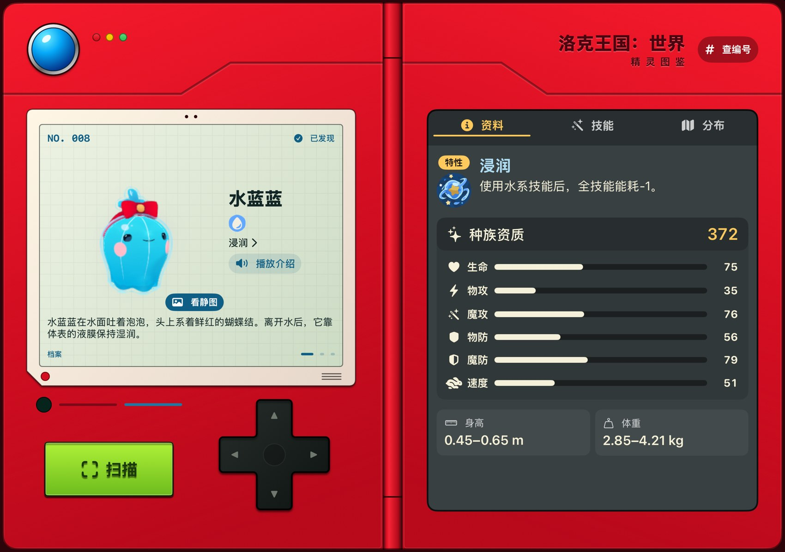
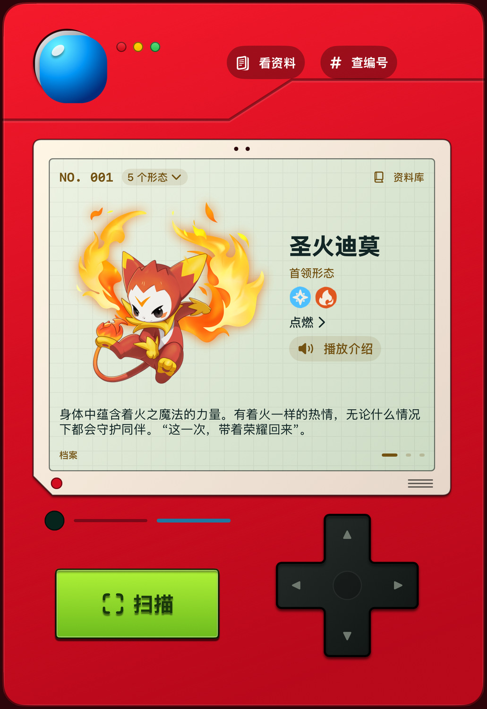
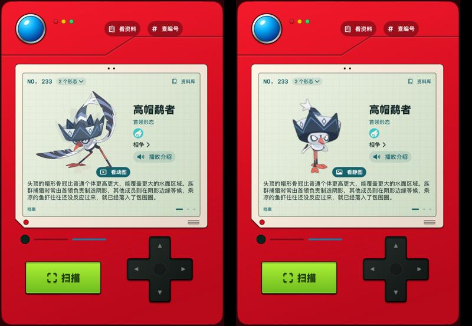
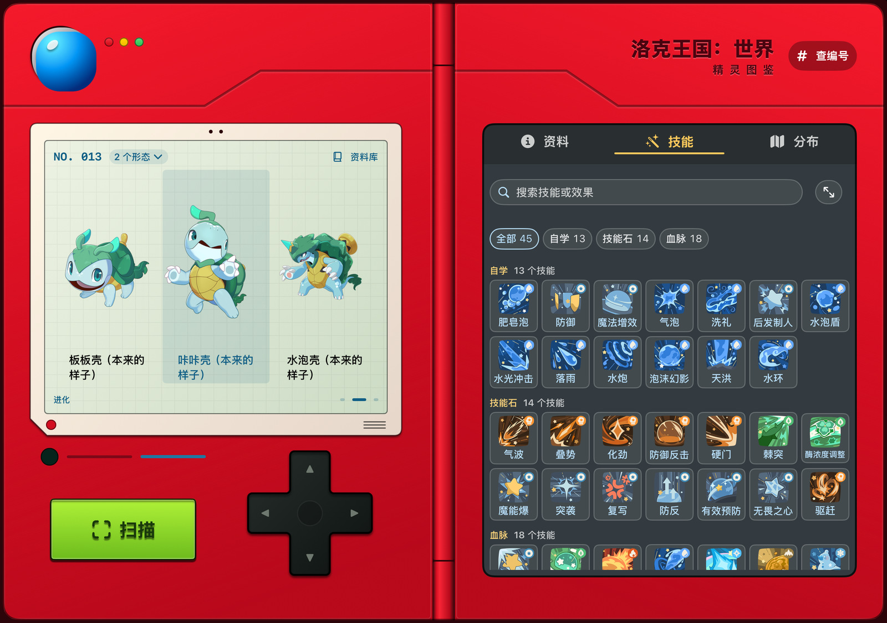
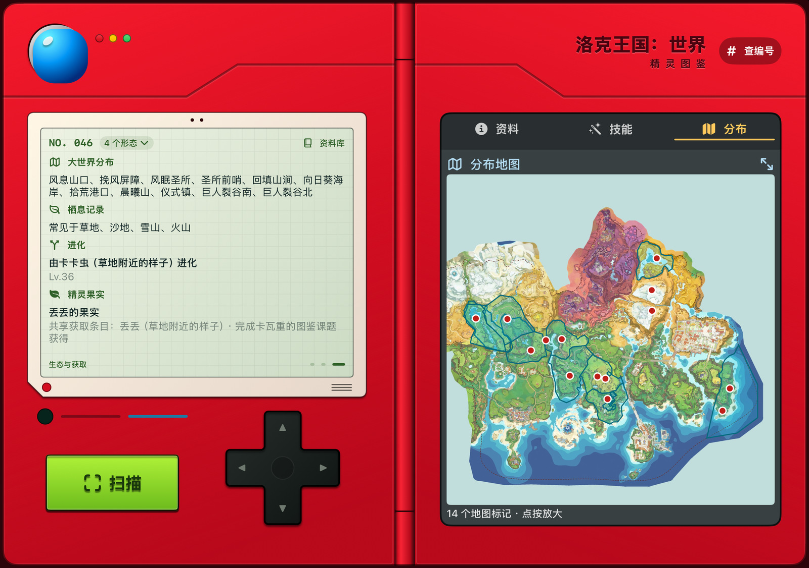

<div align="center">

# RocoDex · 精霊図鑑

[简体中文](README.md) · [English](README.en.md) · **日本語** · [한국어](README.ko.md)

『洛克王国：世界』の非公式オフライン図鑑。iPhone Duo の二つの画面で、精霊の姿と生息地やスキルを見比べられます。

**1.6.2・ビルド 9**　｜　**iOS 27.0 以降**　｜　**図鑑番号 496 件・665 形態**

[1.6.2 をダウンロード](https://github.com/liudbhx7-bot/roco-world-duo-dex/releases/tag/v1.6.2) · [インストール手順](docs/BUILDING.md) · [更新履歴](CHANGELOG.md)

</div>

ゲーム内の精霊のイラストにカメラを向けて、緑色の「扫描」（スキャン）を押します。識別に成功するとその形態の図鑑が開き、発見記録に追加されます。Duo を開くと、左画面で立ち絵を見ながら右画面で特性やスキル、分布を確認できます。閉じているときは「看资料」（資料を見る）で画面を切り替えます。画像認識、地図、音声解説はすべてオフラインで使えます。

アプリの表示は簡体字中国語、音声解説は中国語（普通話）です。このページでは、実際の画面と照合できるように、精霊名とボタン名にアプリ内の表記を使っています。

| Duo を開いた状態。水蓝蓝の立ち絵と種族値 | Duo を閉じた状態。外側の画面で図鑑を表示 |
| :---: | :---: |
| <a href="docs/images/waterblue-duo-1.6.1.jpg"></a> | <a href="docs/images/duo-folded-archive.jpg"></a> |

## 1.6.2 のアニメーションを試す

**421「离心舞者」** を開くと、登場モーションを一度再生し、そのまま待機モーションを繰り返します。大きさを見比べるなら、**233** のボス形態 **「高帽鹬者」** を選び、立ち絵の右下にあるボタンで静止画と動画を切り替えてください。待機中は翼をたたみますが、冠羽から足先まで画面に収まります。「播放介绍」（解説を再生）を押すと機械音が鳴り、左上の青いランプが声の強弱に合わせて明滅します。



## ダウンロードとインストール

**自分の iPhone にインストールする場合**は、未署名 IPA の分割ファイル二つとチェックサムファイルを、Mac の同じフォルダに保存します。[分割ファイル 1](https://github.com/liudbhx7-bot/roco-world-duo-dex/releases/download/v1.6.2/RocoDex-1.6.2-unsigned.ipa.part1) · [分割ファイル 2](https://github.com/liudbhx7-bot/roco-world-duo-dex/releases/download/v1.6.2/RocoDex-1.6.2-unsigned.ipa.part2) · [SHA256SUMS.txt](https://github.com/liudbhx7-bot/roco-world-duo-dex/releases/download/v1.6.2/SHA256SUMS.txt)

そのフォルダで次のコマンドを順に実行します。3 ファイルすべてが `OK` と表示されたら、結合後の IPA に自分の Apple 開発用証明書と端末用のプロビジョニングプロファイルで署名し、インストールしてください。既存の発見記録を引き継ぐには、以前と同じ Bundle ID と互換性のある署名を使って上書きします。

```sh
cat RocoDex-1.6.2-unsigned.ipa.part1 RocoDex-1.6.2-unsigned.ipa.part2 > RocoDex-1.6.2-unsigned.ipa
shasum -a 256 -c SHA256SUMS.txt
```

**Mac でソースから実行する場合**は、ソース ZIP を展開して `RocoDex.xcodeproj` を開き、RocoDex スキームと iPhone Duo シミュレータを選んで **⌘R** を押します。実機で試す場合は、自分の署名チームと接続した iPhone を選んでください。本版のビルドには Xcode 27.2 を使用しました。[1.6.2 のソース ZIP](https://github.com/liudbhx7-bot/roco-world-duo-dex/archive/refs/tags/v1.6.2.zip) · [ビルドと更新の手順（中国語）](docs/BUILDING.md)

## 図鑑を使ってみる

1. 「查编号」（番号検索）を押し、**013** を入力して「查找」（検索）を押すと、咔咔壳のページが開きます。番号を空欄にして検索すると、名前や形態、タイプで絞り込める一覧が開きます。
2. 十字キーの右、または右画面の「技能」（スキル）を押します。左には進化の分岐、右には咔咔壳が覚えられる 45 種のスキルが並びます。「肥皂泡」のカードを開くと、レベル 1 で自力習得する水タイプの魔法攻撃で、威力は 60、消費エネルギーは 1 と分かります。
3. 3 ページ目の「生态与获取」（生態と入手方法）では、入手条件を読みながら地図を拡大・移動し、地点を選べます。形態による分布の違いを見るには、**046「卡瓦重」** を開いて左上の形態ボタンを押してください。

| 咔咔壳の進化とスキル | 卡瓦重の入手方法と分布 |
| :---: | :---: |
| <a href="docs/images/evolution-and-skills.jpg"></a> | <a href="docs/images/habitat-map.jpg"></a> |

高帽鹬者の比較画像は 1.6.2、水蓝蓝の見開き画面は 1.6.1、そのほかの画面例は 1.5 で撮影しました。[「肥皂泡」のスキル詳細を表示](docs/images/skill-detail.jpg)

## 収録内容

- **形態ごとの図鑑。** 番号は 001～496、収録形態は 665 種です。たとえば、同じ 001 番の迪莫と圣火迪莫にも、別々の立ち絵、タイプ、特性、スキル、発見記録があります。
- **カメラ・写真での識別。** 背面カメラで撮るほか、写真を選んだり、精霊を囲んで認識範囲を絞ったりできます。端末内の立ち絵・顔アイコンと照合し、姿が似ている場合は候補から選びます。
- **進化と戦闘データ。** 進化先の立ち絵をタップすると、その形態のページに移動します。スキルは名前や効果で検索し、習得方法で絞り込めます。カードを開くと威力、消費エネルギー、習得条件を確認できます。
- **生態と入手方法。** 663 形態に入手方法または進化条件を収録。301 形態には地図マーカーがあり、さらに 13 形態はエリアの境界を表示できます。生息地は範囲で示し、ボスやチャレンジ地点には専用の印が付きます。精霊データは S5、地図は Wiki の S4「月涌狂想」を使用しています。
- **新規モーション 349 本。** 213 形態で動画を表示でき、そのうち 208 形態には登場と待機の両方があります。形態ごとの立ち絵に合わせて動画の表示サイズを調整しました。枠内のボタンで静止画に戻せます。iOS の「視差効果を減らす」がオンのときは、最初に静止画を表示します。[里拉鳐の登場モーション](RocoDex/Resources/Animations/219-entry.apng) · [水蓝蓝の待機モーション](RocoDex/Resources/Animations/008.apng)
- **オフライン音声解説。** 665 形態それぞれに普通話の音声があります。スキャン時の自動読み上げを有効にすると、認識の確認音に続いて名前、タイプ、特徴を読み上げます。精霊一覧で操作音と自動読み上げを個別に切り替えられます。[水蓝蓝の解説を試聴](https://raw.githubusercontent.com/liudbhx7-bot/roco-world-duo-dex/v1.6.2/RocoDex/Resources/Narration/008.m4a)

## 開発・改編・フィードバック

アプリは Swift、SwiftUI、Vision、AVFoundation で実装しています。形態データと画像・音声素材を同梱しています。以下の資料は中国語です。

| 目的 | 資料 |
| --- | --- |
| 操作、スキャン、地図、音声を確認する | [使い方](使用说明.md) · [よくある質問](docs/FAQ.md) |
| ビルド方法やテスト結果を見る | [ビルドとインストール](docs/BUILDING.md) · [検証記録](docs/VERIFICATION.md) |
| プロジェクトの構成を調べる | [開発への参加](CONTRIBUTING.md) |
| アニメーションや音声を追加する | [形態別アニメーション一覧](动图补充清单.csv) · [ナレーション台本](配音台本.csv) |
| 権限や素材の出典を確認する | [プライバシー](PRIVACY.md) · [資料・素材の出典と権利](THIRD_PARTY.md) |

不具合やデータの誤りを報告する際は、図鑑番号と形態名を添えてください。[問題の報告・訂正の連絡](https://github.com/liudbhx7-bot/roco-world-duo-dex/issues/new/choose)

図鑑の資料は「洛克王国世界 WIKI」を参照しています。Wiki が許諾できる本文・編集資料の改編部分は、CC BY-SA 4.0 で公開しています。ゲームのキャラクター、立ち絵、アイコン、地図などの権利はテンセントおよび各権利者に帰属します。[BWiki の精霊図鑑](https://wiki.biligame.com/nrc/精灵图鉴) · [形態別の出典](RocoDex/Resources/Sources.json)

## ご支援について

図鑑を片手に洛克王国を探索してくださり、ありがとうございます。気になっていた精霊の名前や生息地を見つけるお役に立てたら、Alipay または WeChat Pay で任意のご支援をいただけると励みになります。資料の整理やモーションの追加に役立てます。

<p align="center">
  <a href="docs/support/alipay.jpg"></a>
  <a href="docs/support/wechat.jpg"></a>
</p>
