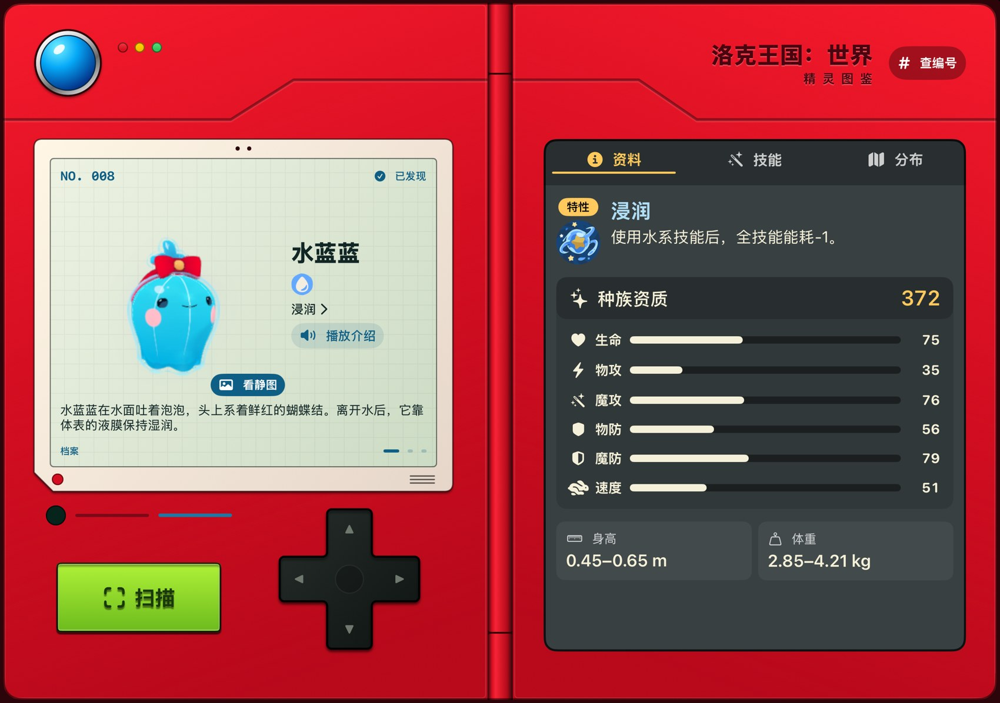
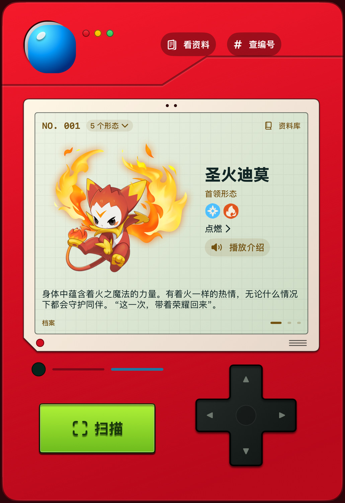
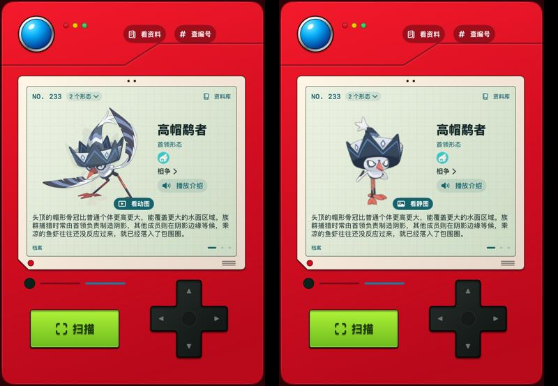
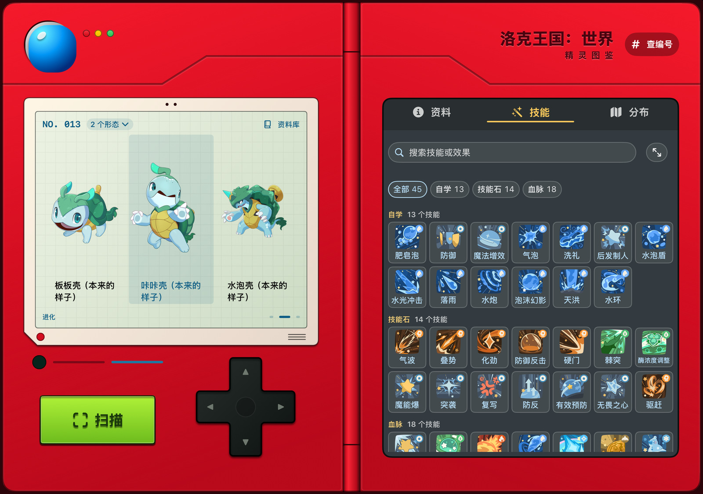
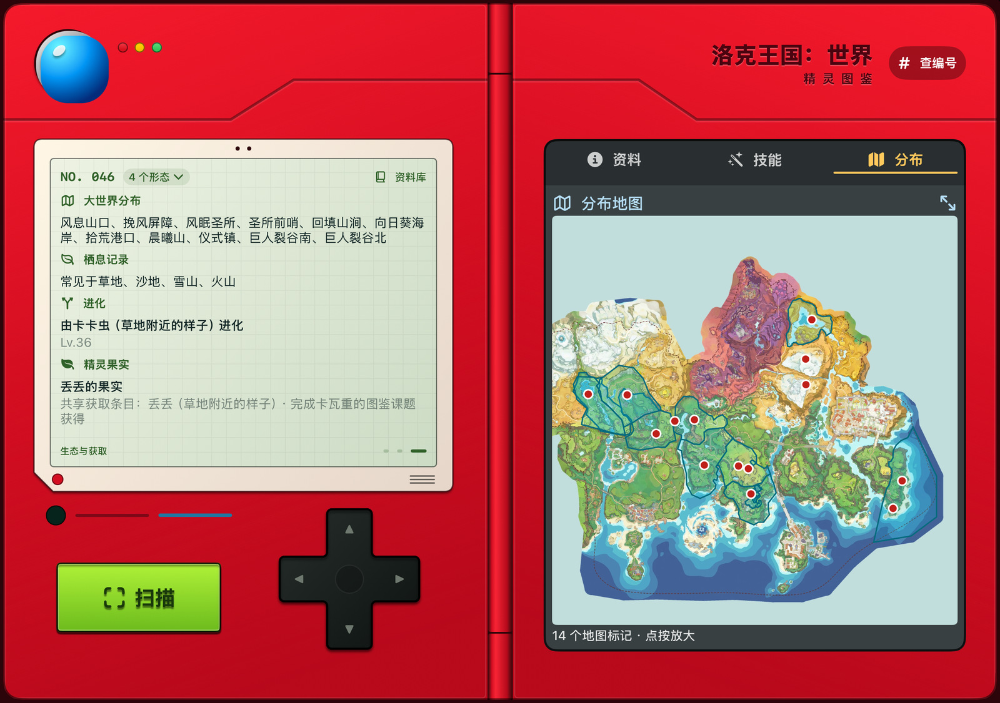

<div align="center">

# RocoDex · 로코 왕국 정령 도감

[简体中文](README.md) · [English](README.en.md) · [日本語](README.ja.md) · **한국어**

iPhone Duo의 두 화면에 맞춘 《洛克王国：世界》 비공식 오프라인 도감입니다.

**1.6.2 · 빌드 9**　｜　**iOS 27.0 이상**　｜　**도감 번호 496개 · 정령 형태 665종**

[1.6.2 다운로드](https://github.com/liudbhx7-bot/roco-world-duo-dex/releases/tag/v1.6.2) · [설치 안내](docs/BUILDING.md) · [버전 기록](CHANGELOG.md)

</div>

게임에 등장하는 정령 일러스트에 카메라를 맞추고 초록색 **扫描**(스캔) 버튼을 누르세요. 인식에 성공하면 해당 형태의 도감이 열리고 발견 기록에 추가됩니다. Duo를 펼치면 왼쪽에는 일러스트가, 오른쪽에는 특성·스킬·분포 자료가 표시됩니다. 접었을 때는 **看资料**(자료 보기)를 눌러 반대쪽 화면으로 이동합니다. 이미지 인식과 지도, 음성 소개는 모두 오프라인에서 이용할 수 있습니다.

앱 화면은 중국어 간체, 음성은 표준 중국어입니다. 아래 정령 이름과 버튼 이름은 앱에서 바로 찾을 수 있도록 화면에 표시되는 중국어를 함께 적었습니다.

| 펼친 화면 · 水蓝蓝의 특성과 능력치 | 접은 화면 · 圣火迪莫 도감 |
| :---: | :---: |
| <a href="docs/images/waterblue-duo-1.6.1.jpg"></a> | <a href="docs/images/duo-folded-archive.jpg"></a> |

## 새 애니메이션 살펴보기

**421번 离心舞者**를 열면 등장 동작이 끝난 뒤 자연스럽게 대기 동작으로 이어집니다. 정지 일러스트와 크기를 비교하려면 **233번**에서 보스 형태 **高帽鹬者**를 고르고 일러스트 오른쪽 아래의 전환 버튼을 누르세요. 날개를 접고 서 있을 때도 머리 장식부터 발끝까지 보입니다. **播放介绍**(소개 재생)를 누르면 기계음과 함께 설명이 시작되고, 왼쪽 위의 파란 표시등이 목소리의 세기에 따라 밝아졌다 어두워집니다.



## 다운로드와 설치

**iPhone에 설치하기.** Mac의 한 폴더에 서명되지 않은 IPA의 분할 파일 두 개와 체크섬 파일을 모두 내려받으세요. [첫 번째 파일](https://github.com/liudbhx7-bot/roco-world-duo-dex/releases/download/v1.6.2/RocoDex-1.6.2-unsigned.ipa.part1) · [두 번째 파일](https://github.com/liudbhx7-bot/roco-world-duo-dex/releases/download/v1.6.2/RocoDex-1.6.2-unsigned.ipa.part2) · [SHA256SUMS.txt](https://github.com/liudbhx7-bot/roco-world-duo-dex/releases/download/v1.6.2/SHA256SUMS.txt)

터미널에서 해당 폴더로 이동한 뒤 다음 두 명령을 차례로 실행하세요. 두 분할 파일과 완성된 IPA에 모두 `OK`가 표시되면 본인의 Apple 개발 인증서와 기기용 프로비저닝 프로파일로 IPA에 서명한 뒤 설치하세요. 발견 기록을 유지하려면 기존 앱과 같은 번들 ID 및 호환되는 서명을 사용해 덮어 설치하세요.

```sh
cat RocoDex-1.6.2-unsigned.ipa.part1 RocoDex-1.6.2-unsigned.ipa.part2 > RocoDex-1.6.2-unsigned.ipa
shasum -a 256 -c SHA256SUMS.txt
```

**Mac에서 소스로 실행하기.** 소스 ZIP의 압축을 풀고 Xcode에서 `RocoDex.xcodeproj`를 여세요. RocoDex 스킴과 iPhone Duo 시뮬레이터를 선택한 뒤 **⌘R**을 누르면 됩니다. 실기기에서 실행하려면 본인의 개발 팀과 연결된 iPhone을 선택하세요. 이 버전은 Xcode 27.2로 빌드했습니다. [소스 ZIP](https://github.com/liudbhx7-bot/roco-world-duo-dex/archive/refs/tags/v1.6.2.zip) · [빌드 및 업데이트 안내(중국어)](docs/BUILDING.md)

## 정령 한 마리를 찾아보세요

1. **查编号**(번호 검색)에서 **013**을 입력하고 **查找**(찾기)를 눌러 咔咔壳의 도감을 여세요. 번호를 비워 둔 채 검색하면 목록에서 이름·형태·속성으로 찾을 수 있습니다.
2. 방향키의 오른쪽을 누르거나 펼친 상태에서 오른쪽 화면의 **技能**(스킬)을 누르세요. 왼쪽에는 진화 분기가, 오른쪽에는 咔咔壳의 스킬 45개가 표시됩니다. **肥皂泡**를 누르면 레벨 1에 스스로 배우는 물 속성 마법 공격이며, 위력은 60이고 에너지는 1을 소모한다는 것을 확인할 수 있습니다.
3. 세 번째 페이지 **生态与获取**(생태와 획득 방법)에서는 획득 조건을 볼 수 있습니다. 지도를 눌러 확대하거나 이동하고 분포 지점을 선택해 보세요. **046번 卡瓦重**은 도감 왼쪽 위에서 형태를 바꿔 분포를 비교할 수 있습니다.

| 咔咔壳의 진화와 스킬 | 卡瓦重의 생태와 분포 |
| :---: | :---: |
| <a href="docs/images/evolution-and-skills.jpg"></a> | <a href="docs/images/habitat-map.jpg"></a> |

高帽鹬者 비교 화면은 1.6.2, 水蓝蓝의 펼친 화면은 1.6.1, 나머지 예시는 1.5에서 촬영했습니다. [肥皂泡 스킬 상세 화면](docs/images/skill-detail.jpg)

## 수록 내용

- **형태별 도감.** 001번부터 496번까지 총 665개 형태를 수록했습니다. 같은 번호여도 형태별로 일러스트·속성·특성·스킬과 발견 기록을 따로 관리합니다.
- **카메라와 사진 인식.** 정령을 촬영하거나 앨범에서 사진을 선택하세요. 여러 정령이 섞인 사진은 인식 영역을 직접 지정할 수 있습니다. 외형이 비슷하면 후보를 표시합니다.
- **진화와 전투 자료.** 진화 분기의 일러스트를 누르면 해당 형태로 이동합니다. 스킬은 이름·효과·습득 경로로 찾을 수 있고, 상세 화면에서 위력·소모 에너지·습득 조건을 확인할 수 있습니다.
- **생태와 획득.** 663개 형태에 확인된 획득 또는 진화 조건이 있습니다. 301개 형태는 지도에 지점이 표시되고, 그 밖의 13개 형태는 분포 구역의 경계를 볼 수 있습니다. 정령 자료는 S5, 바탕 지도는 S4 「月涌狂想」 기준입니다.
- **일러스트와 동작.** 1.6.2에 동작 349개를 새로 추가했습니다. 움직이는 일러스트가 있는 213개 형태 중 208개는 등장 동작과 반복 대기 동작을 모두 갖췄습니다. 일러스트 안의 버튼으로 정지 화면으로 전환할 수 있으며, iOS의 ‘동작 줄이기’를 켜면 정지 화면으로 시작합니다. [里拉鳐 등장 동작](RocoDex/Resources/Animations/219-entry.apng) · [水蓝蓝 대기 동작](RocoDex/Resources/Animations/008.apng)
- **오프라인 음성 소개.** 665개 형태마다 이름·속성·특징을 소개하는 표준 중국어 음성이 있습니다. 목록에서 인식 후 자동 낭독과 조작 효과음을 각각 설정할 수 있습니다. [水蓝蓝 소개 듣기](https://raw.githubusercontent.com/liudbhx7-bot/roco-world-duo-dex/v1.6.2/RocoDex/Resources/Narration/008.m4a)

## 개발·편집·피드백

Swift, SwiftUI, Vision, AVFoundation으로 제작했습니다. 형태 데이터와 미디어가 소스에 포함되어 있어 정령 한 마리의 일러스트나 동작, 소개 음성부터 바꿔 볼 수 있습니다. 아래 문서는 중국어로 제공됩니다.

| 용도 | 문서 |
| --- | --- |
| 검색, 인식, 지도와 음성 사용법 | [사용 설명서](使用说明.md) · [자주 묻는 질문](docs/FAQ.md) |
| 빌드 환경과 테스트 결과 | [빌드 및 설치](docs/BUILDING.md) · [검증 기록](docs/VERIFICATION.md) |
| 프로젝트 구조와 기여 방법 | [기여 안내](CONTRIBUTING.md) |
| 형태별 동작 추가와 녹음 교체 | [동작 목록](动图补充清单.csv) · [녹음 대본](配音台本.csv) |
| 권한, 출처 및 이용 조건 | [개인정보 및 권한](PRIVACY.md) · [자료와 이미지 출처](THIRD_PARTY.md) |

오류나 잘못된 자료를 제보할 때는 도감 번호와 형태 이름을 함께 적어 주세요. [문제 제보 및 자료 정정](https://github.com/liudbhx7-bot/roco-world-duo-dex/issues/new/choose)

도감 자료는 洛克王国世界 WIKI를 참고했습니다. 위키가 이용을 허가할 권한을 보유한 글과 편집 자료의 개작물에는 CC BY-SA 4.0이 적용됩니다. 게임 캐릭터·일러스트·아이콘·지도의 권리는 텐센트와 각 권리자에게 있습니다. [BWiki 정령 도감](https://wiki.biligame.com/nrc/精灵图鉴) · [형태별 출처](RocoDex/Resources/Sources.json)

## 도감 후원

이 도감과 함께 로코 왕국을 탐험해 주셔서 감사합니다. 궁금했던 정령의 이름을 알아내거나 서식지를 찾는 데 도움이 되었다면 Alipay 또는 WeChat Pay로 자유롭게 후원하실 수 있습니다. 보내 주신 후원은 도감 자료를 정리하고 새로운 동작을 추가하는 데 쓰입니다.

<p align="center">
  <a href="docs/support/alipay.jpg"></a>
  <a href="docs/support/wechat.jpg"></a>
</p>
