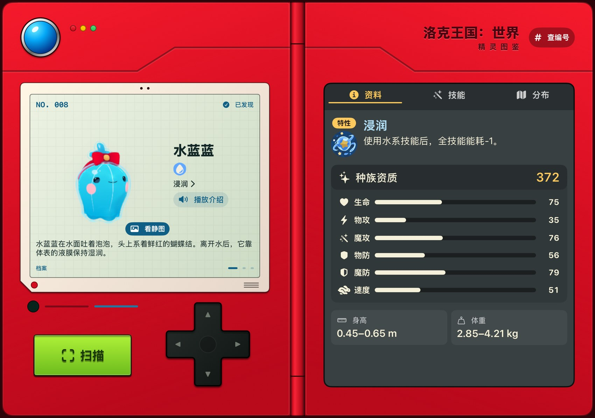
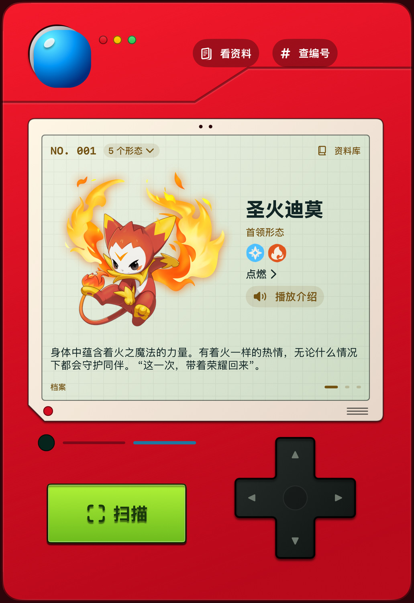
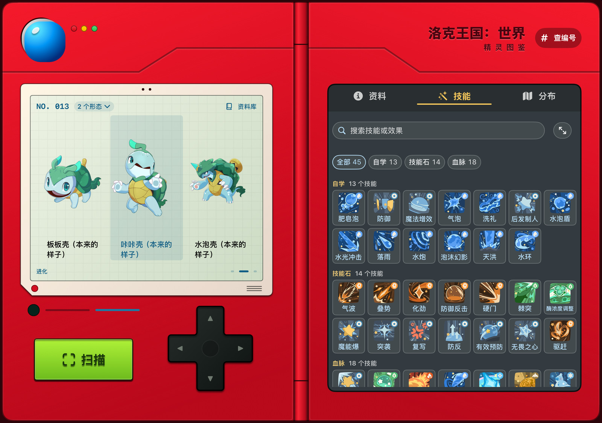
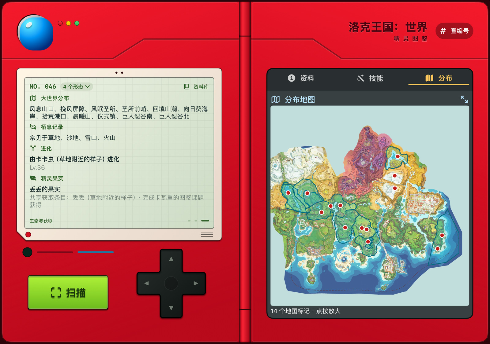

# 洛克精灵图鉴

《洛克王国：世界》的非官方离线图鉴，专为 iPhone Duo 的双屏设计。

**1.6.1 · 构建 8**　｜　**iOS 27.0+**　｜　**496 个编号 · 665 份形态档案**

[**下载待签名 IPA**](https://github.com/liudbhx7-bot/roco-world-duo-dex/releases/download/v1.6.1/RocoDex-1.6.1-unsigned.ipa) · [**安装指南**](docs/BUILDING.md) · [**1.6.1 发布页**](https://github.com/liudbhx7-bot/roco-world-duo-dex/releases/tag/v1.6.1)

对准游戏里的精灵立绘按下「扫描」，识别成功后就会点亮它的发现记录。展开 Duo，左屏翻精灵档案，右屏同时查特性、技能和分布；合拢后，点「看资料」即可翻到另一侧。立绘识别、地图和普通话介绍均可离线使用。

| Duo 展开 · 水蓝蓝的档案与种族资质 | Duo 合拢 · 单屏档案 |
| :---: | :---: |
|  |  |

**试试 1.6.1 的新动作。** 输入 **219** 打开里拉鳐，它会在立绘框内完成出场，随后循环待机。点「播放介绍」，听到开场机械音后，左上角的蓝灯会跟着播报的轻重明暗变化。介绍结束时有一声卡嗒，按方向键翻页也能听到回弹声。

## 下载与安装

| 用途 | 获取方式 |
| --- | --- |
| 安装到自己的 iPhone | [下载 1.6.1 待签名 IPA](https://github.com/liudbhx7-bot/roco-world-duo-dex/releases/download/v1.6.1/RocoDex-1.6.1-unsigned.ipa)，使用自己的 Apple 开发签名。首次安装也可直接用 Xcode 运行到真机。[安装与覆盖升级](docs/BUILDING.md) |
| 在 Mac 上构建或体验模拟器 | [下载 1.6.1 源码 ZIP](https://github.com/liudbhx7-bot/roco-world-duo-dex/archive/refs/tags/v1.6.1.zip)，解压后打开 `RocoDex.xcodeproj`。本版使用 Xcode 27.2 构建。 |
| 核对下载、查看历史版本 | [SHA-256 校验文件](https://github.com/liudbhx7-bot/roco-world-duo-dex/releases/download/v1.6.1/SHA256SUMS.txt) · [版本记录](CHANGELOG.md) · [历次发布](https://github.com/liudbhx7-bot/roco-world-duo-dex/releases) |

## 三步看懂一只精灵

1. **找一只精灵。** 点「查编号」，输入 **013** 后点「查找」，打开咔咔壳。也可以留空直接查找，从名册按精灵名、形态或系别筛选。
2. **看它会什么。** 按十字键向右，或在展开的右屏点「技能」。左侧出现进化分支，右侧能看到咔咔壳的 45 个技能。点「肥皂泡」就能查到自学 Lv.1、水系魔攻、威力 60、能耗 1。
3. **去地图找它。** 打开第三页「生态与获取」，左侧列出已收录的获取途径，点右侧地图可放大、拖动和选择地点。要看不同形态的分布，可查 **046 卡瓦重**，从档案左上角切换形态。

| 咔咔壳 · 进化与技能 | 卡瓦重 · 生态与分布 |
| :---: | :---: |
|  |  |

水蓝蓝展开图取自 1.6.1，其余示例截图取自 1.5。点击图片可放大。[查看「肥皂泡」技能详情截图](docs/images/skill-detail.jpg)

## 图鉴收录了什么

- **独立形态档案。** 游戏编号从 001 到 496，同编号的特殊形态单独收录，总计 665 份。以 001 为例，迪莫和圣火迪莫有各自的立绘、系别、特性、技能和发现记录。
- **相机与相册识别。** 支持后置相机拍摄、从相册选图和手动框选。相似精灵会列为候选，方便对照确认。匹配使用设备上的立绘和头像索引。
- **进化与战斗资料。** 点进化分支可跳转到对应形态。技能卡可按名字、效果及学习来源查找，详情包含威力、能耗与学习条件。
- **生态与获取。** 663 个形态有可核实的获取或进化途径。301 个形态有地图标记，另有 13 个可显示区域边界。栖息地标注代表一片区域，首领与挑战点另行标注。精灵资料采用 S5 记录，底图采用来源站的 S4「月涌狂想」地图。
- **立绘与动作。** 39 个形态有动态立绘，其中 33 个备有完整的出场和待机动作。点立绘框内的按钮可切回静图。开启系统「减弱动态效果」后，档案默认显示静图。[观看里拉鳐出场](RocoDex/Resources/Animations/219-entry.apng) · [观看水蓝蓝待机](RocoDex/Resources/Animations/008.apng)
- **离线播报。** 665 个形态各有独立的普通话介绍。扫描识别成功后，确认音响完就会报出名字、系别，再介绍精灵的特征。可在名册里分别开关操作音效和自动朗读。[试听水蓝蓝的介绍](https://raw.githubusercontent.com/liudbhx7-bot/roco-world-duo-dex/v1.6.1/RocoDex/Resources/Narration/008.m4a)

## 开发、改编与反馈

应用使用 Swift、SwiftUI、Vision 和 AVFoundation。形态档案与媒体随工程提供，可从一只精灵的动图、录音或资料入手修改。

| 文档 | 适合用来做什么 |
| --- | --- |
| [完整使用说明](使用说明.md) · [常见问题](docs/FAQ.md) | 查找形态、扫描识别、查看地图或排查播报问题 |
| [构建与安装](docs/BUILDING.md) · [验证记录](docs/VERIFICATION.md) | 在模拟器或真机运行，查看已测试的功能和环境 |
| [参与维护与工程目录](CONTRIBUTING.md) | 找到界面、扫描和数据文件，了解如何验证自己的修改 |
| [动图补充清单](动图补充清单.csv) · [配音台本](配音台本.csv) | 按中文名和形态找文件，替换 APNG 动图，或按台词录制新的介绍 |
| [隐私与权限](PRIVACY.md) · [资料与美术来源](THIRD_PARTY.md) | 了解相机、发现记录和外链的用途，查阅各项素材的来源与许可 |

遇到使用问题或发现资料有误，可以在 Issues 里选相应模板。注明精灵编号和形态名，能帮助定位同编号下的不同档案。[反馈使用问题或资料勘误](https://github.com/liudbhx7-bot/roco-world-duo-dex/issues/new/choose)

档案整理参考洛克王国世界 WIKI。可授权的 Wiki 文字与整理资料的改编沿用 CC BY-SA 4.0，游戏角色、图标、地图和立绘等美术归腾讯及相应权利人所有。[BWiki 精灵图鉴](https://wiki.biligame.com/nrc/精灵图鉴) · [逐形态来源](RocoDex/Resources/Sources.json)

## 感谢支持

谢谢你带着这本图鉴探索洛克王国。如果它帮你认出了一只精灵，或找到了想去的栖息地，欢迎通过支付宝或微信随意打赏，支持我继续整理资料、补充动作。

  
  

